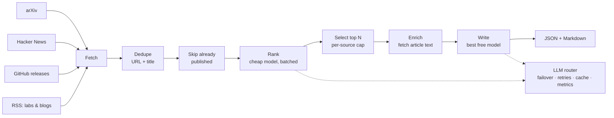

# Research Digest Agent

A daily AI news digest built entirely on **free LLM APIs**. It pulls from arXiv, Hacker News,
GitHub releases and lab/engineering blogs, merges duplicates, ranks everything with a cheap
model, and has the best available free model write a short, cited, source-faithful summary of
the top stories. It runs on GitHub Actions and costs **$0/month**.

**Live dashboard:** https://hsr99.github.io/research-digest-agent/ (updated after every run)



## Why it's built this way

| Decision | Reason |
|---|---|
| **Provider-agnostic router** (`digest/llm.py`) | OpenRouter, NVIDIA NIM and Ollama all speak the OpenAI chat format. Each role has an ordered list of models; when one is busy or down, the router moves to the next. Free-tier rate limits become a non-issue. |
| **Free-only guard** | The router refuses to start if any configured model could be billed: every provider must be marked free, and OpenRouter models must be `:free` ones. Zero cost is enforced, not just intended. |
| **Two model roles** | Ranking 60 candidates is high volume and low stakes, so it goes to a small, fast model. Writing 8 summaries is low volume and high stakes, so it goes to the best free model. |
| **Validated JSON output** | Every reply is parsed and checked against the expected shape. On a bad reply the model gets one chance to fix it, then the next provider takes over. Small free models break JSON often; this makes them usable. |
| **SQLite response cache** | Identical requests are never paid for twice, so reruns and eval experiments are free. |
| **Per-call metrics** | Every call logs provider, model, tokens, latency and errors, which shows up in each digest's footer. |
| **"Seen" store** | Stories published once never reappear, even when arXiv or HN resurface them. |
| **Faithfulness rules in the writer prompt** | The writer may only use the source text and must attribute vendor claims ("Z.ai says…") instead of stating them as fact. |
| **Degrades instead of failing** | If every model fails during ranking, everything is re-ranked with a keyword formula (source, HN points, topic keywords, off-topic penalty). If writing fails, stories use the source's own text. The digest is marked as a reduced edition, but a day is never missed. |
| **Per-source isolation** | A dead feed is logged and skipped; it can't take down the run. |

## Quick start

```powershell
pip install -r requirements.txt
copy .env.example .env      # then add at least one free API key
python -m digest            # writes out/YYYY-MM-DD.md and .json
python -m digest.site       # builds the dashboard into site/ (open site/index.html via a local server)
```

No key yet? `python -m digest --no-llm` runs the whole pipeline with heuristic ranking and no summaries.

Options: `--hours 48` widens the lookback window, `-v` shows what the router is doing.
Everything else (topic, sources, models and their order) lives in [`config.toml`](config.toml).

## Run it on GitHub

1. Push this folder to a GitHub repo.
2. Settings → Secrets and variables → Actions: add `OPENROUTER_API_KEY` and `NVIDIA_API_KEY`.
3. Settings → Pages → Source: **GitHub Actions**.
4. The workflow in `.github/workflows/daily-digest.yml` runs when you press **Run workflow** (the daily 19:00 IST schedule is commented out in the file; uncomment it to turn it back on): it runs the tests, builds the digest, commits it, and publishes the dashboard to GitHub Pages.

The dashboard is plain static HTML generated by [`digest/site.py`](digest/site.py): today's stories with a tag filter, the pipeline funnel, sources, the models that answered, the ranker's close calls, and run history. The raw digests are served next to it at `data/<date>.json`.

## Tests

```powershell
python -m pytest -q
```

The router tests use a fake HTTP transport, so they cover failover, retries, JSON repair and caching without network access or keys.

## Roadmap

- [ ] **Digest Arena:** compare this pipeline against a curated AI digest on coverage, precision, faithfulness (LLM-as-judge), source diversity and freshness
- [ ] Embedding-based dedupe (same story, different titles)
- [x] Public dashboard on GitHub Pages
- [ ] Email / Slack delivery
